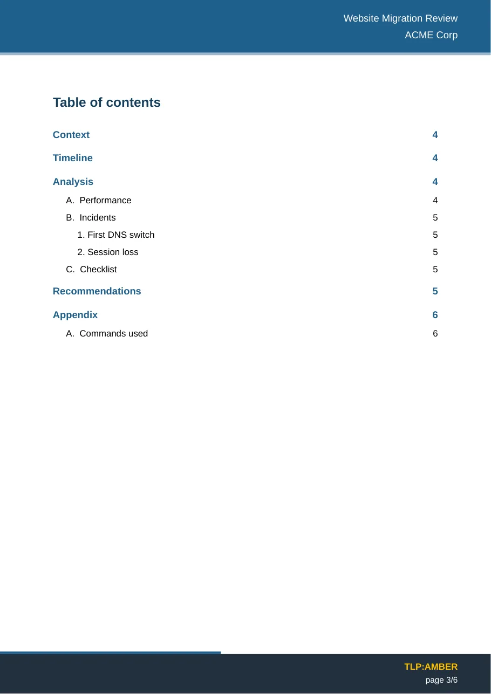
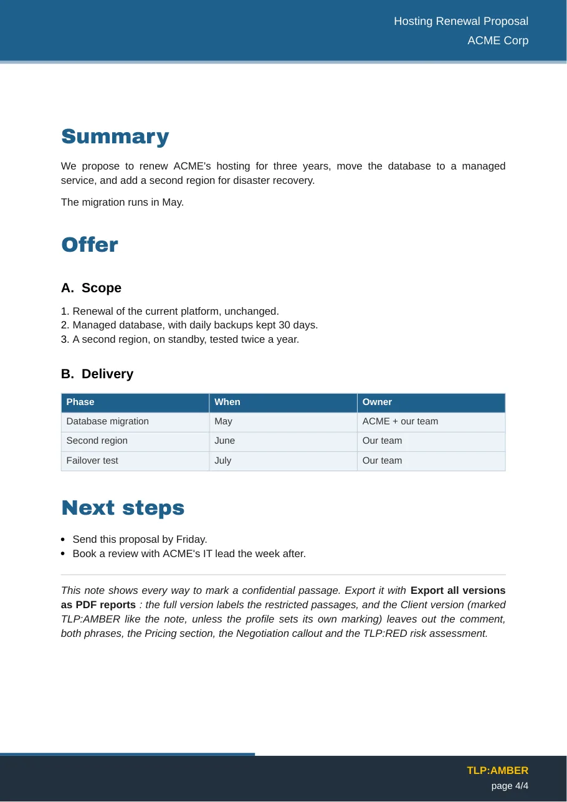

<p align="center">
  <picture>
    <source media="(prefers-color-scheme: dark)" srcset="website/en/docs/assets/images/logo-horizontal-dark.svg">
    
  </picture>
</p>

<p align="center">
  <strong>Transformez vos notes Obsidian en rapports PDF et Word professionnels.</strong><br>
  Modèles à votre charte · page de garde · sommaire · Mermaid · callouts · versions client sans les passages internes
</p>

<p align="center">
  <a href="https://github.com/Phdhebde/Obisidian-pdf-export/releases/latest"></a>
  <a href="https://github.com/Phdhebde/Obisidian-pdf-export/releases"></a>
  <a href="https://github.com/Phdhebde/Obisidian-pdf-export/actions/workflows/ci.yml"></a>
  <a href="https://scorecard.dev/viewer/?uri=github.com/Phdhebde/Obisidian-pdf-export"></a>
  <a href="https://www.bestpractices.dev/projects/16382"></a>
  <a href="LICENSE"></a>
  
</p>

<p align="center">
  <a href="https://phdhebde.github.io/Obisidian-pdf-export/fr/"><b>Documentation</b></a> ·
  <a href="#installation"><b>Installer</b></a> ·
  <a href="https://github.com/Phdhebde/Obisidian-pdf-export/releases/latest"><b>Télécharger</b></a> ·
  <a href="README.md"><b>English version</b></a>
</p>

<table align="center">
  <tr>
    <td></td>
    <td></td>
    <td></td>
  </tr>
  <tr>
    <td align="center"><sub>Page de garde</sub></td>
    <td align="center"><sub>Sommaire</sub></td>
    <td align="center"><sub>Corps : tableaux, callouts, Mermaid</sub></td>
  </tr>
</table>

# Report Exporter

Le plugin Obsidian pour des **rapports PDF et Word personnalisés et professionnels**. Exporte n'importe quelle note en **rapport soigné**, à votre charte : page de garde, bandeaux d'en-tête et de pied de page, sommaire, tableaux stylés, callouts Obsidian avec leurs icônes, schémas Mermaid en vectoriel, colonnes, notes de bas de page, images — le tout piloté par des **modèles** personnalisables, duplicables et partageables, sélectionnés au moment de l'export.

### Points forts

- **PDF et Word depuis une seule note** — le `.docx` est mis en page comme le PDF, ou rempli dans le modèle `.dotx` de votre entreprise.
- **Modèles réutilisables** — couleurs, polices, numérotation, page de garde, papier à en-tête ; partageables en un seul fichier JSON.
- **Une version par public** — le rapport interne complet et une version client, dont les passages internes sont retirés *avant* le rendu (jamais simplement masqués), avec arrêt en cas de doute.
- **Markdown Obsidian natif** — callouts, Mermaid en vectoriel, notes de bas de page, listes de tâches, notes intégrées, Obsidian Columns, wikiliens.
- **Marquage TLP** pour les équipes sécurité et CERT.
- **Confidentiel par conception** — entièrement hors ligne : aucune requête réseau, aucun compte, polices embarquées.

### Sommaire

[Installation](#installation) · [Utilisation](#utilisation) · [Passages confidentiels](#passages-confidentiels) · [Export Word](#export-word) · [Modèles](#modèles) · [Limites](#limites) · [Feuille de route](#feuille-de-route) · [Licence](#licence)

*Report Exporter s'appelait PDF Report Exporter jusqu'à la version 2.0. L'identifiant du plugin, les réglages et les commandes ne changent pas.*

Le plugin fonctionne entièrement hors ligne : aucune requête réseau, et les polices nécessaires sont embarquées.

L'interface suit la langue d'Obsidian (français ou anglais).

---

## Installation

**Depuis le store :** *Paramètres → Modules complémentaires → Parcourir*, cherchez **Report Exporter**, installez puis activez.

**Manuellement :** téléchargez `main.js`, `manifest.json` et `styles.css` depuis la [dernière release](https://github.com/Phdhebde/Obisidian-pdf-export/releases/latest) dans `<coffre>/.obsidian/plugins/pdf-report-exporter/`, puis activez le plugin.

Ordinateur uniquement.

---

## Utilisation

### Exporter

| Comment | Ce que ça fait |
|---|---|
| Commande **« Exporter en rapport PDF »** (`Ctrl/Cmd+P`) ou l'icône du ruban | Exporte la note active |
| Commande **« Aperçu du rapport PDF »** | Génère le PDF et **l'ouvre dans Obsidian** — le moyen rapide de régler un modèle |
| Commande **« Exporter la sélection en rapport PDF »** | N'exporte que le texte sélectionné |
| Commande **« Exporter en rapport PDF avec un profil… »** | Exporte une version de la note : la complète, ou un profil comme *Client* (voir Passages confidentiels) |
| Commande **« Exporter toutes les versions en rapports PDF »** | Écrit la version complète et un PDF par profil, chacun sous son propre nom |
| Commande **« Exporter en document Word »**, avec ou sans profil | Écrit le même rapport en `.docx` (voir Export Word) |
| **Clic droit sur une note** | Exporte cette note |
| **Clic droit sur un dossier** | Exporte toutes ses notes, une par une, avec un compte-rendu final |
| Commande **« Insérer le frontmatter de rapport »** | Insère le bloc YAML pré-rempli (date du jour, contacts par défaut) |

Avec plusieurs modèles, une fenêtre demande lequel utiliser (clavier : `↑ ↓`, `Entrée`, `Échap`). Elle est ignorée s'il n'y a qu'un modèle, si la note en désigne un, ou si vous avez coché **« Ne plus demander »**.

### Frontmatter

Toutes les clés sont facultatives ; les clés françaises et anglaises sont acceptées indifféremment :

```yaml
---
titre: Rapport d'audit                # couverture + en-tête (défaut : nom de la note)
client: ACME                          # sous le titre dans l'en-tête
sous_titre: Équipe infrastructure
acronyme: INFRA
auteur: Camille Martin                # métadonnées du PDF
logo: logos/acme.png                  # logo sur la page de garde
modele: Rapport                       # impose un modèle, sans fenêtre de sélection
sections: [cover, toc, body]          # surcharge les sections pour cette note
tlp: AMBER                            # marquage Traffic Light Protocol (facultatif)
versions:                             # tableau « Statut du document »
  - version: "1.0"
    date: "08/06/2026"
    etat: "Création du document"
contacts:                             # tableau « Contacts »
  - nom: "Camille Martin"
    poste: "Cheffe de projet"
    courriel: "camille.martin@exemple.fr"
destinataires:                        # tableau « Destinataires » (facultatif)
  - nom: "Jean Dupont"
    societe: "ACME"                   # ou `poste:`, qui a la priorité
    courriel: "jean.dupont@exemple.fr"
---
```

Attention à ne pas confondre `destinataire` (singulier, alias de `client`) et `destinataires` (pluriel, la liste du tableau).

**TLP (facultatif) :** sans clé `tlp`, aucun marquage n'est imprimé — sauf si le modèle inclut la page *Rappel TLP*, auquel cas le rapport est marqué `TLP:CLEAR`. Une valeur non reconnue déclenche un avertissement ; `WHITE` (TLP 1.0) est converti en `CLEAR`.

### Markdown

Titres numérotés automatiquement (`A.`, `1.`, `a)` par défaut, réglable par niveau), liens cliquables, listes et cases à cocher, **callouts** Obsidian avec leur icône, tableaux ajustés à la page, blocs de code, **schémas Mermaid** vectoriels, **colonnes** du plugin *Obsidian Columns*, légendes (`*Figure 1 : …*`), **notes de bas de page** (`texte[^1]` et `[^1]: note`, ou `texte^[note]`, réunies sous *Notes* à la fin du rapport), images (`![[capture.png|400]]`), notes incluses (`![[autre note]]`) et sauts de page (`\pagebreak` sur sa propre ligne). Les listes placées sous un titre `# Recommandations` prennent des puces losange (désactivable).

Le détail de chaque convention est dans le [README anglais](README.md#markdown). Les commentaires Obsidian (`%%…%%`) ne figurent dans aucun export.

### Passages confidentiels

Une note, plusieurs livrables : une version interne complète, et une version par public (un client, un partenaire) d'où les passages marqués pour l'équipe sont **retirés avant le rendu**. Ils ne sont jamais masqués par un bandeau noir : le texte n'est pas du tout dans le fichier, ni dans son sommaire, ses liens ou ses métadonnées.

| Portée | Dans la note |
|---|---|
| Note entière | `audience: internal` dans son frontmatter. L'exporter avec un profil qui exclut `internal` s'arrête avec un message ; incluse par `![[…]]` dans une autre note, elle est retirée de cette version. |
| Section | `## Tarifs %%internal%%` : le titre et tout ce qu'il contient, jusqu'au prochain titre de même niveau ou de niveau supérieur |
| Bloc | `> [!internal] Négociation` : le callout, ses citations imbriquées et les lignes qui le prolongent |
| Phrase | `<span data-audience="internal">12 %</span>` |
| Par niveau TLP | `## Sources %%tlp:red%%`, `<span data-tlp="red">…</span>`, ou `tlp: red` dans le frontmatter d'une note incluse |

Les **profils** (*Réglages → Passages confidentiels*) indiquent les niveaux qu'une version conserve, le suffixe ajouté au nom du fichier (`Rapport-client.pdf`), si une mention « [passage retiré] » signale les coupes, et le marquage TLP. Une première installation propose un profil *Client* qui retire tous les passages marqués. Une note peut choisir son profil avec `profile: Client` ; sans cela, l'export habituel produit la version complète.

Les **niveaux** se déclarent dans les mêmes réglages : `internal` par défaut, ajoutez les vôtres (`management`, `direction`…). Un passage marqué de plusieurs niveaux ne figure que dans une version qui les conserve tous.

**TLP :** un passage marqué d'un niveau TLP ne reste que dans les versions marquées au moins aussi strictement. Le marquage d'un profil est son propre réglage TLP, sinon le `tlp:` de la note ; sans l'un ni l'autre, la version compte comme `TLP:CLEAR` et tous les passages marqués TLP sont retirés. La version complète garde tout.

**Voir ce qui est restreint :** dans une version qui les conserve (en général la complète), les sections restreintes, les callouts `[!internal]` de premier niveau et les notes incluses s'ouvrent sur une étiquette orange (*INTERNAL*, *TLP:RED*…) et se ferment par un trait pointillé, et les phrases marquées sont surlignées : un relecteur voit ce que les autres versions ne contiendront pas. Dans Obsidian, les callouts `[!internal]` s'affichent en orange avec un cadenas, et les phrases marquées avec un soulignement pointillé. Le repérage dans le PDF se désactive dans les réglages.

**Journal des exports (facultatif) :** après chaque export avec un profil, une ligne est ajoutée à une note *Journal des exports PDF* dans le dossier de sortie : la note, le fichier écrit et ce qui a été retiré (des nombres, jamais le texte retiré).

**En cas de doute, l'export s'arrête** : un niveau inconnu (`audience: internl`) ou une phrase marquée sans son `</span>` bloque l'export avec un message, plutôt que de laisser passer le passage. Après chaque export restreint, une notice indique ce qui a été retiré, par exemple *Profil « Client » : retiré 1 section, 2 phrases.*

Limite : les champs du frontmatter imprimés sur la couverture et la page de références (titre, client, contacts…) ne sont pas filtrés. N'y mettez pas d'informations confidentielles.

Pour essayer, exportez [example-confidential.md](example-confidential.md) avec *Exporter toutes les versions en rapports PDF*.

### Export Word

**« Exporter en document Word »** écrit la note en `.docx`, avec le même filtre de confidentialité. Sans modèle Word, le document est mis en page comme le PDF : page de garde, bandeaux, page de références, rappel TLP et vrai sommaire Word. Avec votre propre `.dotx` ou `.docx` (réglages du modèle → *Export Word*), sa page de garde, ses en-têtes, ses pieds de page et ses styles sont conservés : écrivez `{{title}}`, `{{client}}`, `{{date}}`, `{{version}}`, `{{status}}`, `{{tlp}}`… là où vont les valeurs de la note, `{{toc}}` pour le sommaire, `{{versions}}`, `{{contacts}}` et `{{recipients}}` pour leurs tableaux, et `{{content}}`, seul, dans le paragraphe où va le rapport. Les styles sont retrouvés par leur nom interne : un modèle enregistré par Word dans n'importe quelle langue fonctionne.

Les notes de bas de page deviennent de vraies notes Word, les légendes numérotées reçoivent un champ de séquence pour la table des illustrations de Word, et les colonnes Obsidian Columns se placent côte à côte. Trois modèles d'exemple écrits dans Word sont dans [`templates/word`](templates/word).

À l'ouverture, Word demande de mettre à jour les champs du document : répondez *Oui* pour avoir les numéros de page dans le sommaire. Détails : [Export Word](https://phdhebde.github.io/Obisidian-pdf-export/fr/word-export/).

---

## Modèles

*Paramètres → Report Exporter.* Un modèle **Rapport** est créé au premier lancement. Pour chaque modèle : sections et leur ordre, numérotation et sommaire par niveau de titre, couleurs, polices et taille du texte, positions de la page de garde, format de pagination, libellés fixes, et **habillage** — par défaut le modèle dessine lui-même son décor à ses couleurs ; choisissez vos propres images A4 (fond de couverture, cadre des pages avec votre papier à en-tête) pour le remplacer.

**Partage d'équipe :** « Exporter ce modèle » écrit un `.report-template.json` autonome (images incluses) dans le coffre ; un collègue l'importe depuis la même liste.

**Reprendre un modèle existant :** un fichier de modèle `.json` exporté par une version antérieure ou un outil interne au même format (objet `{ "preset": … }` ou modèle seul) s'importe aussi : les champs manquants sont complétés par les valeurs par défaut, et les images incluses sont conservées.

---

## Limites

- **Polices :** Liberation Sans (équivalent métrique d'Arial), Liberation Mono et Archivo Black, embarquées — d'où un `main.js` d'environ 5 Mo. Les écritures non couvertes (CJK, arabe…) ne s'affichent pas.
- **Sommaire :** cliquable, mais sans points de conduite (pdfmake ne le permet pas).
- **Colonnes :** un groupe de colonnes n'est pas coupé entre deux pages.
- Dataview et les requêtes dynamiques ne sont pas rendus. Format A4 uniquement.

---

## Feuille de route

La suite se décide avec la communauté. Gratuit et communautaire, sans version payante : voir [ROADMAP.md](ROADMAP.md) (en anglais), [CONTRIBUTING.md](CONTRIBUTING.md) pour contribuer, et donnez votre avis dans les issues.

## Licence

Code : [MIT](LICENSE). Composants et polices embarqués : voir [THIRD_PARTY_NOTICES.md](THIRD_PARTY_NOTICES.md).
