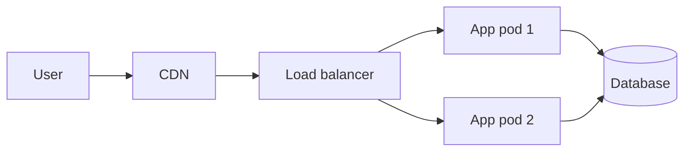

# Context

In May 2026, the ACME Corp website was moved from a single virtual machine to a managed
container platform. This report reviews the migration, the incidents met along the way and
the work that remains.

> [!info] Scope
> The review covers the public website and its API. The internal intranet is out of scope.

# Timeline

| Date       | Step                              | Owner      | Outcome   |
|------------|-----------------------------------|------------|-----------|
| 2026-05-04 | Inventory of services             | J. Smith   | Done      |
| 2026-05-11 | Staging environment ready         | J. Smith   | Done      |
| 2026-05-18 | DNS switch                        | J. Doe     | Rolled back |
| 2026-05-25 | DNS switch, second attempt        | J. Doe     | Done      |

*Table 1: Main migration steps*

# Analysis

## Performance

Median response time dropped from **420 ms** to **180 ms** after the move. The gain comes
mostly from the CDN placed in front of the static assets.



*Figure 1: Target architecture*

## Incidents

### First DNS switch

The first switch was rolled back after 20 minutes: the TLS certificate of the new
platform did not cover the `www` subdomain.

> [!warning] Lesson learned
> Check every hostname against the certificate **before** lowering the DNS TTL.

### Session loss

Users were logged out once during the switch, because sessions were stored in memory on the
old machine. They now live in a shared cache.

## Checklist

- [x] Certificates cover every hostname
- [x] Sessions stored outside the application
- [ ] Load test at twice the peak traffic
- [ ] Disaster recovery drill

# Recommendations

- Automate certificate checks in the deployment pipeline.
- Run the load test before the autumn campaign.
- Document the rollback procedure:
  - DNS records and their previous values
  - Who decides, and how fast

\pagebreak

# Appendix

## Commands used

```bash
kubectl rollout status deployment/website
curl -sI https://www.example.com | head -n 1
```

````col
```col-md
flexGrow=1
===
**Before**

One virtual machine, manual deployments.
```

```col-md
flexGrow=1
===
**After**

Two pods behind a load balancer, deployments from CI.
```
````
