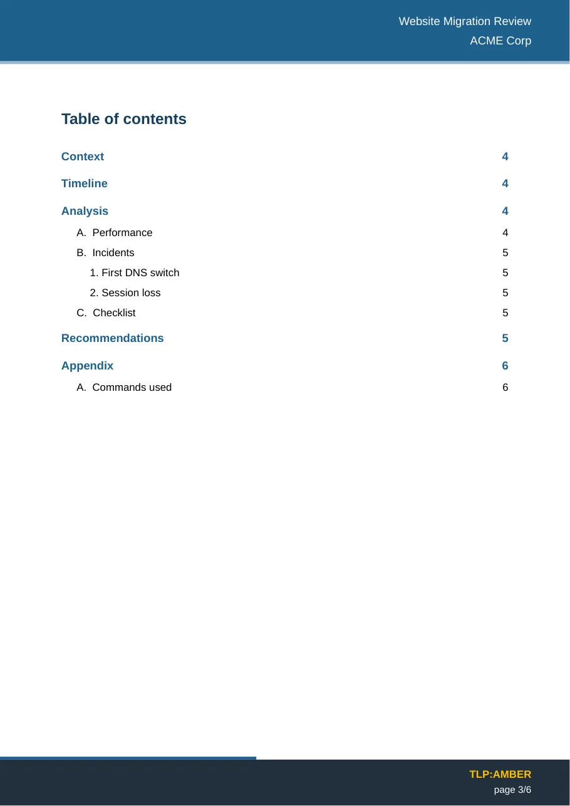

# Getting started

This page takes you from installation to your first exported report in about five minutes.

## Install the plugin

=== "From the community store"

    1. In Obsidian, open **Settings → Community plugins**. If needed, turn off *Restricted mode*.
    2. Click **Browse**, search for **PDF Report Exporter**, then **Install** and **Enable**.

=== "Manually"

    1. Download `main.js`, `manifest.json` and `styles.css` from the [latest release](https://github.com/Phdhebde/Obisidian-pdf-export/releases/latest).
    2. Put them in `<your vault>/.obsidian/plugins/pdf-report-exporter/`.
    3. Restart Obsidian, then enable **PDF Report Exporter** in **Settings → Community plugins**.

The plugin works on Obsidian **1.8.7 or later**, desktop only.

## Export your first report

1. Open a note, or create one with a few headings and paragraphs.
2. Run **Insert report frontmatter** from the command palette (++ctrl+p++ / ++cmd+p++). It adds a pre-filled block at the top of the note:

    ```yaml
    ---
    title: Website Migration Review
    client: ACME Corp
    subtitle: Infrastructure team
    versions:
      - version: "1.0"
        date: "2026-10-19"
        status: "Document created"
    contacts:
      - name: "Jane Doe"
        role: "Project lead"
        email: "jane.doe@example.com"
    ---
    ```

3. Fill in the title and client, then run **Preview PDF report**. The PDF opens in an Obsidian tab; run the preview again after each change.
4. When it looks right, run **Export as PDF report**. The file is written to the vault root, or to the output folder set in the settings, and a notice offers to open it or show it in its folder.

{ loading=lazy width="420" }

## Every way to export

| How | What it does |
|---|---|
| **Export as PDF report** command, or the ribbon icon | Exports the active note |
| **Preview PDF report** command | Renders the PDF and opens it inside Obsidian, reusing the same file and tab |
| **Export selection as PDF report** command | Exports only the selected text |
| **Export as PDF report with a profile…** command | Exports one version: the full one, or a profile such as *Client* — see [Confidential export](confidential-export.md) |
| **Export all versions as PDF reports** command | Writes the full version and one PDF per profile |
| Right-click a note in the file explorer | Exports that note |
| Right-click a folder | Exports every note in it, one PDF each, with a summary at the end |

When you have several templates, a picker asks which one to use. It is skipped when there is only one, when the note names one with `template:` in its frontmatter, or once you tick **Don't ask again**.

## Where to go next

- [Frontmatter](frontmatter.md): every key the cover and the references page read.
- [Markdown](markdown.md): what each piece of Markdown becomes in the PDF.
- [Templates](templates.md): colours, numbering, cover layout, your own letterhead.
- [Confidential export](confidential-export.md): one note, a full version and a client version.
- Try the two example notes from the repository: [`example-report.md`](https://github.com/Phdhebde/Obisidian-pdf-export/blob/main/example-report.md) and [`example-confidential.md`](https://github.com/Phdhebde/Obisidian-pdf-export/blob/main/example-confidential.md).
