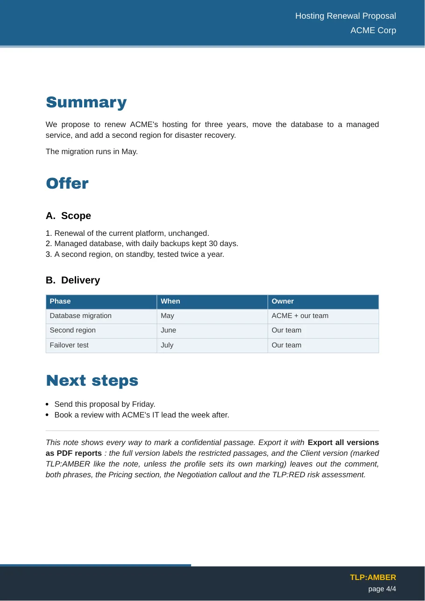

# Export Obsidian notes as professional PDF reports

**PDF Report Exporter** is a free, open-source [Obsidian](https://obsidian.md) plugin that turns a Markdown note into a report you can send: a cover page, header and footer bands, a clickable table of contents, styled tables, Obsidian callouts with their icons, and Mermaid diagrams drawn as vectors. Templates set the look; the note stays plain Markdown.

If you are looking for an Obsidian plugin to **export custom, professional PDFs** — with your company's colours, fonts, logo and letterhead, and nothing else to install — this is what it was built for. How it compares with Obsidian's built-in export, Better Export PDF and the others: [Obsidian PDF export plugins compared](compare.md).

[Get started](getting-started.md){ .md-button .md-button--primary }
[Download the latest release](https://github.com/Phdhebde/Obisidian-pdf-export/releases/latest){ .md-button }

<div class="grid" markdown>

{ loading=lazy width="300" }

{ loading=lazy width="300" }

</div>

## What it does

| You write in Obsidian | You get in the PDF |
|---|---|
| A note with a few frontmatter keys (`title`, `client`, `versions`, `contacts`) | A cover page, a references page with document status and contacts, header and footer on every page |
| `#`, `##`, `###` headings | Numbered headings (`A.`, `1.`, `a)`… configurable) and a clickable, paginated table of contents |
| `> [!warning]` callouts, tables, task lists, code | Callouts with their Lucide icons, tables fitted to the page, vector check boxes, code blocks |
| ` ```mermaid ` blocks | Diagrams drawn by Obsidian's own Mermaid, embedded as vectors |
| `![[image.png]]`, `![[another note]]` | Embedded images (WEBP, SVG, GIF… converted) and inlined notes |
| `## Pricing %%internal%%` | A full internal version, and a client version with that section removed |
| **Export as Word document (beta)** | The same report as a `.docx`, or filled into your own `.dotx` template — see [Word export](word-export.md) |

## Why use it

- **Reports, not printouts.** Obsidian's built-in *Export to PDF* prints the note as it looks on screen. PDF Report Exporter lays it out as a document: cover, table of contents, page numbers, running header, TLP marking.
- **Templates you can share.** Colours, fonts, numbering, cover layout, page number format and your own letterhead artwork live in templates. Export one as a JSON file and a colleague imports it.
- **One note, several audiences.** Mark what must stay internal; export a full version for the team and a client version from which those passages are removed before rendering — never hidden under a black box. See [Confidential export](confidential-export.md).
- **Private by design.** No network access, no account, no telemetry. The fonts ship inside the plugin, so it works offline.
- **English and French.** The interface follows Obsidian's language, and frontmatter keys are understood in both.

## Install in one minute

1. In Obsidian, open **Settings → Community plugins → Browse**.
2. Search for **PDF Report Exporter**, install it, then enable it.
3. Open a note and run **Export as PDF report** from the command palette (++ctrl+p++ / ++cmd+p++).

Details, manual installation and the first-export walkthrough: [Getting started](getting-started.md).

!!! info "Requirements"
    Obsidian **1.8.7 or later**, on desktop (Windows, macOS, Linux). Mobile is not supported: the PDF engine and fonts need the desktop app.

## Free and community-driven

The plugin is MIT-licensed, has no paid tier and never will. Ideas, bug reports, templates and translations are welcome in the [GitHub issues](https://github.com/Phdhebde/Obisidian-pdf-export/issues). What comes next — footnotes, captions and columns in Word, then the move to the *Report Exporter* name — is in the [roadmap](roadmap.md).
