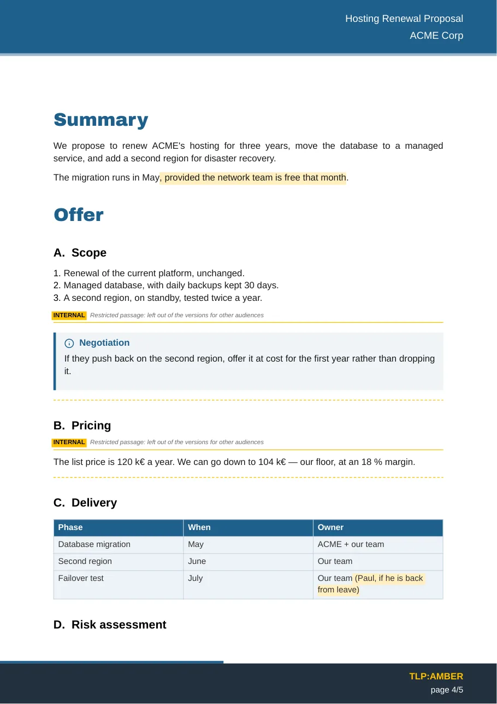
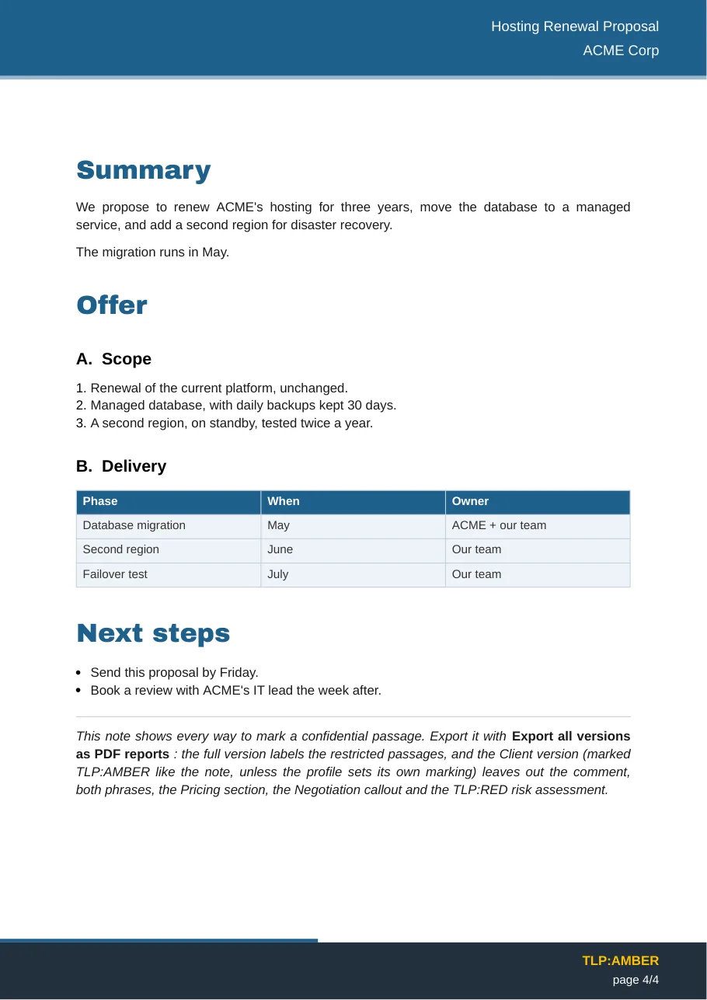

# Export confidentiel

Une note, plusieurs livrables : une version interne complète, et une version par public (un client, un partenaire) d'où les passages marqués pour votre équipe sont **retirés avant le rendu du PDF**. Ils ne sont jamais masqués par un bandeau noir : le texte n'est pas du tout dans le fichier, ni dans son sommaire, ses liens ou ses métadonnées.

<div class="grid" markdown>

<figure markdown>
{ loading=lazy width="340" }
<figcaption>Version complète : les passages restreints sont étiquetés</figcaption>
</figure>

<figure markdown>
{ loading=lazy width="340" }
<figcaption>Version client : ils ont disparu</figcaption>
</figure>

</div>

## Marquer ce qui doit rester interne

| Portée | Dans la note |
|---|---|
| Note entière | `audience: internal` dans son frontmatter |
| Section | `## Tarifs %%internal%%` : le titre et tout ce qu'il contient, jusqu'au prochain titre de même niveau ou de niveau supérieur |
| Bloc | `> [!internal] Négociation` : le callout, ses citations imbriquées et les lignes qui le prolongent |
| Phrase | `<span data-audience="internal">12 %</span>` |
| Par niveau TLP | `## Sources %%tlp:red%%`, `<span data-tlp="red">…</span>`, ou `tlp: red` dans le frontmatter d'une note incluse |

Dans Obsidian, les callouts `[!internal]` s'affichent en orange avec un cadenas, et les phrases marquées avec un soulignement pointillé : vous voyez ce qui est restreint pendant que vous écrivez.

```markdown
## Tarifs %%internal%%

Le prix catalogue est de 120 k€ par an. Nous pouvons descendre à 104 k€.

## Livraison

| Phase | Responsable |
| --- | --- |
| Test de bascule | Notre équipe<span data-audience="internal"> (Paul, s'il est rentré)</span> |
```

## Exporter les versions

- **Exporter en rapport PDF** produit la version complète, sauf si la note désigne un profil avec `profil: Client`.
- **Exporter en rapport PDF avec un profil…** demande quelle version produire.
- **Exporter toutes les versions en rapports PDF** écrit la version complète et un fichier par profil : `Proposition.pdf`, `Proposition-client.pdf`…

Après chaque export restreint, une notice indique ce qui a été retiré, par exemple *Profil « Client » : retiré 2 sections, 1 bloc, 2 phrases.*

## Profils et niveaux

**Réglages → PDF Report Exporter → Passages confidentiels** :

- **Niveaux de diffusion** : `internal` par défaut ; ajoutez les vôtres (`management`, `direction`…). Un passage marqué de plusieurs niveaux ne figure que dans une version qui les conserve tous.
- **Profils** : pour chaque public, les niveaux conservés, le suffixe ajouté au nom du fichier, l'affichage éventuel d'une mention *[passage retiré]* à chaque coupe, et le marquage TLP. Un profil *Client* qui retire tous les passages marqués est créé à l'installation.
- **Signaler les passages restreints** : dans les versions qui les conservent, indique où commence et finit chaque section, callout ou note incluse restreint, et surligne les phrases marquées.
- **Journaliser les exports restreints** : ajoute une ligne par export restreint à une note *Journal des exports PDF* — quelle note, quel fichier, ce qui a été retiré (des nombres, jamais le texte).

## Niveaux TLP

Un passage marqué d'un niveau TLP ne reste que dans les versions marquées au moins aussi strictement. Le marquage d'un profil est son propre réglage TLP, sinon le `tlp:` de la note ; sans l'un ni l'autre, la version compte comme `TLP:CLEAR` et tous les passages marqués TLP sont retirés. La version complète garde tout.

## Règles de sécurité

- **Retiré avant le rendu.** Les passages marqués sont coupés du Markdown avant que le moteur PDF ne le lise : les images, schémas et liens qu'ils contiennent ne sont même pas chargés.
- **En cas de doute, l'export s'arrête.** Un niveau inconnu (`audience: internl`, `%%tlp:rouge%%`) ou une phrase marquée sans son `</span>` bloque l'export avec un message, au lieu de laisser passer le texte.
- **Testé.** La suite de tests place un secret partout où du texte peut passer — sections, tableaux, callouts, liens, texte des images, code Mermaid, titres — et vérifie qu'aucun n'atteint une version client.
- **Non couvert** : les champs du frontmatter imprimés sur la couverture et la page de références (titre, client, contacts) ne sont pas filtrés.

Pour essayer, exportez [`example-confidential.md`](https://github.com/Phdhebde/Obisidian-pdf-export/blob/main/example-confidential.md) avec **Exporter toutes les versions en rapports PDF**.
