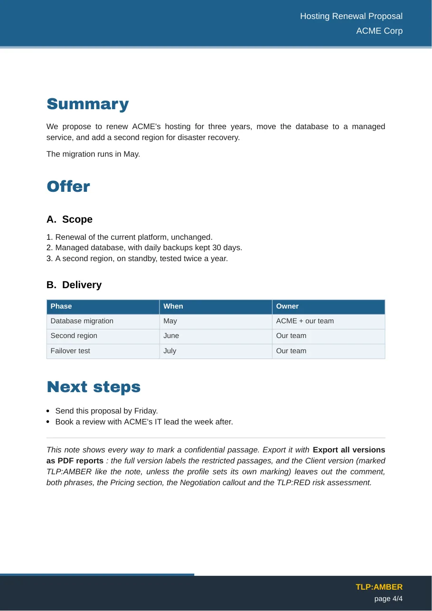

# Exporter ses notes Obsidian en rapports PDF et Word professionnels

**Report Exporter** est un plugin [Obsidian](https://obsidian.md) gratuit et open source qui transforme une note Markdown en rapport prêt à envoyer : page de garde, bandeaux d'en-tête et de pied de page, sommaire, tableaux mis en forme, callouts Obsidian avec leurs icônes, schémas Mermaid en vectoriel, notes de bas de page. Les modèles fixent l'apparence ; la note reste du Markdown ordinaire.

Une note, plusieurs livrables :

- **Un PDF**, mis en page d'après les modèles du plugin — vos couleurs, polices, logo et papier à en-tête, sans rien installer d'autre.
- **Un document Word**, mis en page comme le PDF, ou rempli dans le modèle `.dotx` de votre entreprise pour que la charte vienne du modèle lui-même.
- **Une version par public** : le rapport interne complet, et une version client d'où les passages marqués comme internes sont retirés avant le rendu.

Report Exporter s'appelait *PDF Report Exporter* jusqu'à la version 2.0 ; le plugin, ses réglages et ses commandes sont les mêmes. Comment il se situe par rapport à l'export intégré d'Obsidian, Better Export PDF et les autres : [comparatif des plugins d'export PDF pour Obsidian](compare.md).

[Premiers pas](getting-started.md){ .md-button .md-button--primary }
[Télécharger la dernière version](https://github.com/Phdhebde/Obisidian-pdf-export/releases/latest){ .md-button }

<div class="grid" markdown>

{ loading=lazy width="300" }

{ loading=lazy width="300" }

</div>

## Ce qu'il fait

| Vous écrivez dans Obsidian | Vous obtenez dans le rapport |
|---|---|
| Une note avec quelques clés de frontmatter (`titre`, `client`, `versions`, `contacts`) | Une page de garde, une page de références avec l'état du document et les contacts, un en-tête et un pied de page sur chaque page |
| Des titres `#`, `##`, `###` | Des titres numérotés (`A.`, `1.`, `a)`… réglables) et un sommaire : paginé et cliquable dans le PDF, un vrai sommaire Word dans le `.docx` |
| Des callouts `> [!warning]`, tableaux, listes de tâches, code | Des callouts avec leurs icônes Lucide, des tableaux ajustés à la page, des cases à cocher, des blocs de code |
| Des blocs ` ```mermaid ` | Des schémas dessinés par le Mermaid d'Obsidian, intégrés en vectoriel |
| `![[image.png]]`, `![[autre note]]` | Des images intégrées (WEBP, SVG, GIF… convertis) et des notes incluses |
| `texte[^1]`, `*Figure 1 : …*` | Des notes de bas de page et des légendes — de vraies notes Word et des légendes numérotées dans le `.docx` |
| `## Tarifs %%internal%%` | Une version interne complète, et une version client sans cette section |

## Pourquoi l'utiliser

- **Des rapports, pas des impressions.** L'export PDF intégré d'Obsidian imprime la note telle qu'elle s'affiche. Report Exporter la met en page comme un document : page de garde, sommaire, numéros de page, en-tête courant, marquage TLP.
- **PDF ou Word, à partir de la même note.** Envoyez un PDF, ou un `.docx` que votre client peut modifier — dans son propre modèle s'il en a un. Voir [Export Word](word-export.md).
- **Des modèles partageables.** Couleurs, polices, numérotation, mise en page de la couverture, format des numéros de page et votre propre papier à en-tête vivent dans des modèles. Exportez-en un en JSON, un collègue l'importe.
- **Une note, plusieurs publics.** Marquez ce qui doit rester interne ; exportez une version complète pour l'équipe et une version client d'où ces passages sont retirés avant le rendu, jamais masqués par un bandeau noir. Voir [Export confidentiel](confidential-export.md).
- **Respect de la vie privée.** Aucun accès réseau, aucun compte, aucune télémétrie. Les polices sont incluses dans le plugin : il fonctionne hors ligne.
- **Anglais et français.** L'interface suit la langue d'Obsidian, et les clés du frontmatter sont comprises dans les deux langues.

## Installation en une minute

1. Dans Obsidian, ouvrez **Réglages → Plugins communautaires → Parcourir**.
2. Cherchez **Report Exporter**, installez-le, puis activez-le.
3. Ouvrez une note et lancez **Exporter en rapport PDF** ou **Exporter en document Word** depuis la palette de commandes (++ctrl+p++ / ++cmd+p++).

Détails, installation manuelle et premier export pas à pas : [Premiers pas](getting-started.md).

!!! info "Prérequis"
    Obsidian **1.8.7 ou plus récent**, sur ordinateur (Windows, macOS, Linux). Le mobile n'est pas pris en charge : le moteur PDF et les polices ont besoin de l'application de bureau.

## Gratuit et communautaire

Le plugin est sous licence MIT, sans version payante, et le restera. Idées, signalements de bugs, modèles Word et traductions sont les bienvenus : voir [comment contribuer](https://github.com/Phdhebde/Obisidian-pdf-export/blob/main/CONTRIBUTING.md) et la [feuille de route](roadmap.md).
